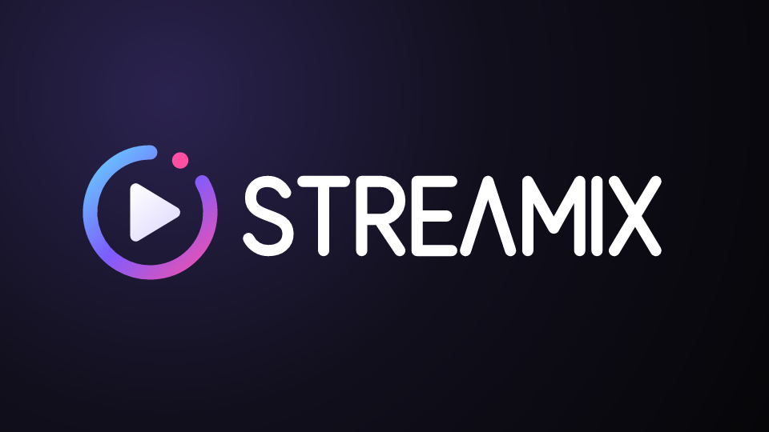
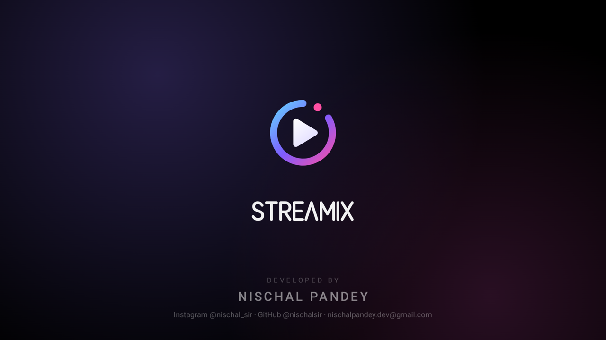
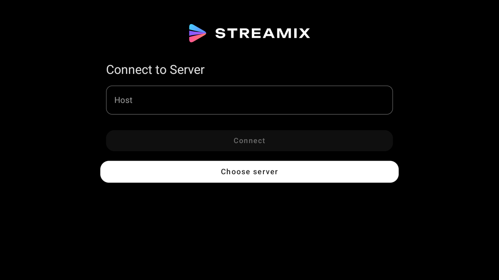
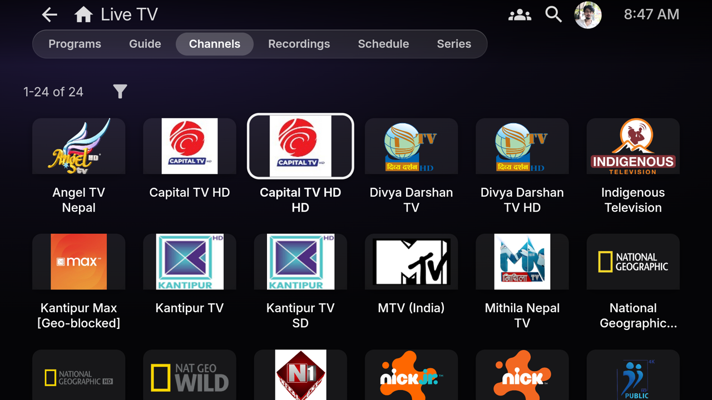
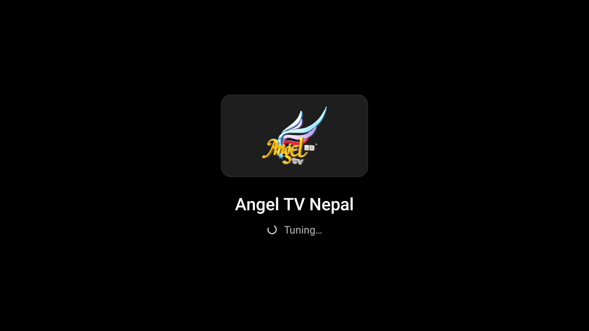

<p align="center">
  
</p>

<h3 align="center">A Jellyfin client for Google TV and Android TV — Liquid Glass design, native 4K HDR playback, Dolby Atmos and DTS.</h3>

<p align="center">
  <a href="https://github.com/nischalsir/Streamix/releases/latest"><b>Download the latest APK</b></a>
  ·
  <a href="#2-install-it-on-your-tv-from-a-usb-drive">Install</a>
  ·
  <a href="#3-connect-to-your-jellyfin-server">Connect</a>
  ·
  <a href="#troubleshooting">Troubleshooting</a>
</p>

---

Streamix turns your Jellyfin server into a living-room app. Browsing uses the Jellyfin web interface in its
TV layout, so your server's **Liquid Glass** theme applies everywhere. Video plays in a **native player**, so
4K HDR10 (HEVC 10-bit), Dolby Atmos and DTS play directly from the server without transcoding.

It was built for a **TCL 43V6C (Google TV, 2 GB RAM)** and tuned so a budget TV stays smooth.

<p align="center">
  
</p>

<p align="center">
  
  
</p>

**Developed by Nischal Pandey** · Instagram [@nischal_sir](https://instagram.com/nischal_sir) ·
GitHub [@nischalsir](https://github.com/nischalsir) · nischalpandey.dev@gmail.com

## Features

| | |
|---|---|
| **Made for the TV** | Appears on the Google TV home screen with its own banner. Every screen works with the remote. |
| **Apple TV style home** | The focused title's artwork fills the background, posters lift with a white rim, library tiles use clean artwork (no text baked in), and the top bar is one row: logo, a glass tab capsule, search, profile and clock. |
| **Liquid Glass look** | The web UI opens in TV layout with your server's custom CSS, plus a Streamix layer for focus effects, spacing, detail-page artwork and the login screen. |
| **Smooth on budget TVs** | GPU-heavy effects (live blur, hundreds of GPU layers) are switched off on TVs. Release build, R8-optimised. |
| **Native 4K HDR player** | Media3 / ExoPlayer with hardware decoding. HDR10 and HEVC 10-bit play directly. |
| **Judder-free motion** | Switches the TV to the video's frame rate (24p, 25p, 50p) when the panel supports it. |
| **Dolby Atmos, DTS, TrueHD** | Dolby Digital, Dolby Digital Plus (Atmos), DTS / DTS-HD and TrueHD are sent untouched to your TV, soundbar or AV receiver, or decoded on the TV (FFmpeg) if nothing downstream can. |
| **Every subtitle type** | SRT, WebVTT, TTML, styled ASS/SSA (libass), PGS (Blu-ray), VobSub (DVD), DVB and MP4 text, with a theater style: white text, soft shadow, no box. |
| **Profile-picture login** | Login shows your users' profile pictures over your server's poster-collage background. |
| **Remote-first player** | ◀ ▶ seek 10 s instantly, holding them scrubs with thumbnails, OK plays/pauses, Back hides the controls and then exits. |
| **Live TV** | Your server's TV channels (a tuner or an IPTV / M3U playlist) in a clean grid of channel logos. OK starts a channel straight away, its logo shows while it tunes, ▲ ▼ or CH+ / CH− flip channels like a TV box, and number keys jump to a channel number. Comes with a ready-made list of about 170 free Hindi and English channels. |
| **Animated splash** | Three colour streams glide in and merge into the Streamix play arrow, then it fades into your home screen once that has loaded (press OK to skip). |
| **Updates itself** | Streamix checks GitHub for new releases, downloads the update and installs it, all from the TV. No USB drive needed after the first install. |
| **Simple settings** | The TV shows only settings a viewer needs, in plain words. Technical options keep sensible defaults and stay reachable from a computer. |
| **Everything else from Jellyfin** | TV guide and recordings, music, books, Quick Connect, multiple servers, playback speed, chapter skip, intro/outro skip, trickplay thumbnails. |

---

## 1. Requirements

- A **Jellyfin server** (10.9 or newer; tested with 12.2) on your computer or NAS.
- A **Google TV or Android TV** (Android 9+). Tested on TCL 43V6C.
- The TV and the server on the **same home network** (or a server reachable over the internet).
- A **USB drive** (FAT32 or exFAT) to carry the APK to the TV.

## 2. Install it on your TV from a USB drive

1. Download the APK (`Streamix-v1.2.0.apk` or newer) from the
   [latest release](https://github.com/nischalsir/Streamix/releases/latest) and copy it to the USB drive.
2. On the TV, install a file manager from the Play Store: **File Commander** or **FX File Explorer**.
3. Allow that file manager to install apps:
   1. **Settings → System → About**, then select **Android TV OS build** 7 times until it says you're a developer.
   2. **Settings → Apps → Security & restrictions → Unknown sources**, and turn on your file manager.
      (Menu names differ slightly between firmware versions.)
4. Plug in the USB drive, open the file manager, select the APK, then **Install**.
5. **Streamix** appears in **Apps**. To pin it to the home row, long-press it and choose **Add to favourites**.

> **Updating:** from version 1.1, Streamix updates itself. When a new version is out it offers
> **Update now**. You can also check yourself in **Settings → Streamix Settings → Check for updates**.
> The first time, Android asks you to allow Streamix to install apps: turn it on, press **Back**, and the
> update continues. Your server, login and settings are kept. (From 1.0.0, install 1.1 once by USB.)

## 3. Connect to your Jellyfin server

### Find your server address

The TV can't use `localhost`. It needs the **LAN IP address** of the computer running Jellyfin.

- **Windows:** open Command Prompt, run `ipconfig`, and find **IPv4 Address** (for example `192.168.1.20`).
- **macOS:** System Settings → Wi-Fi → Details → **IP address**.
- **Linux / NAS:** `ip addr`, or check your router's list of connected devices.

Your server address is then `http://<that IP>:8096`, for example **`http://192.168.1.20:8096`**.
Check it from a phone on the same Wi-Fi first: opening that address in its browser should show the Jellyfin login page.

> Give the server a **fixed IP** (a "DHCP reservation" in your router), or the address can change after a restart.

### Allow it through the firewall (Windows)

The first time Jellyfin runs, Windows asks whether to allow it on networks. If you missed that prompt:
**Windows Security → Firewall & network protection → Allow an app through firewall →** tick **Jellyfin** for
**Private** networks. Also make sure your Wi-Fi is set to **Private**, not Public.

### Connect from the TV

1. Open **Streamix**. After the splash, you see **Connect to Server** with **Choose server** highlighted.
2. Press **OK** on **Choose server**: Jellyfin servers on your network appear in a list. Select yours.
   Or move up to **Host**, press **OK** to open the keyboard, type the address (`http://192.168.1.20:8096`)
   and select **Connect**.
3. Sign in, either by choosing your **profile picture** or with your username and password.
   With **Quick Connect** turned on (Dashboard → General), you can also approve the sign-in from your phone.

Streamix remembers the server and your login. To switch servers later: **your avatar → Select Server**.
Streamix's own options (surround sound, smoother motion, buffering, subtitle size, updates) are under
**Settings → Streamix Settings**.

## 4. Server setup for the best experience

All of this is done once, in the Jellyfin web interface on your computer (`http://localhost:8096`) as an administrator.

### Show profile pictures on the login screen

Jellyfin only shows users on the login screen if they aren't hidden:

1. **Dashboard → Users →** select a user.
2. Untick **Hide this user from login screens**, then **Save**. Repeat for each user who should appear.
3. To set a picture, each user goes to **their avatar → Profile** and selects the image to upload one.

On the TV, the login screen then shows a row of round profile pictures. Select one and enter the password,
or nothing at all if that user has no password.

> If every user is hidden (the safer default for servers on the internet), Streamix shows the username and password form instead.

### Login background

The login screen uses your server's **splash screen** artwork, a collage of your library's posters:

1. **Dashboard → General → Branding** (on some versions, **Dashboard → Branding**).
2. Tick **Enable the splash screen**. Optionally upload your own image under **Splash screen**, then **Save**.

With it turned off, the login screen shows the Streamix colour glow instead.

### Apply the Liquid Glass theme

Streamix styles itself on top of the server's custom CSS, so the theme lives on the server and also applies in browsers:

1. **Dashboard → General → Custom CSS code**.
2. Paste the whole of [`theme/liquid-glass.css`](theme/liquid-glass.css), then **Save**.
3. Each user: **Settings → Display → Theme → Dark**.

On TVs, Streamix automatically switches the theme's live blur to a solid tint, so it stays smooth.

### Direct play (no transcoding)

Streamix tells the server it can play HEVC/H.264/AV1/VP9 video and AC3, E-AC3, DTS and TrueHD audio as they are,
so most files **direct play**. Two server settings help:

- **Dashboard → Users → (user) → Allow media playback / Allow video playback that requires transcoding:** keep
  transcoding allowed as a fallback for files the TV can't decode.
- **Dashboard → Playback → Transcoding → Hardware acceleration:** enable it if your server has a GPU, so the
  rare transcodes don't stutter.

## 5. Sound: Dolby Atmos, DTS and TrueHD

Streamix never converts surround audio on the server. The TV decides what to do with it:

| Your setup | What happens |
|---|---|
| **TV speakers** | Dolby Digital / Digital Plus are decoded by the TV. DTS and TrueHD are decoded by Streamix (FFmpeg) and mixed to stereo. |
| **Soundbar on HDMI ARC** | Dolby Digital Plus **with Atmos** is passed through. DTS passes through if the soundbar supports it. |
| **Soundbar / receiver on HDMI eARC** | Everything is passed through, including **TrueHD Atmos** and **DTS-HD MA / DTS:X**. |

TV settings to check (TCL Google TV): **Settings → Display & Sound → Audio output**: choose your soundbar
(**HDMI ARC/eARC**). Under **Digital output**, choose **Auto** or **Passthrough**.

**No sound on some videos?** In Streamix go to **Settings → Streamix Settings** and turn off
**Surround sound to soundbar**. Everything is then decoded on the TV, which always works.

## 6. Subtitles

- Choose subtitles from the **subtitles button** in the player, or set a default language in **Settings → Subtitles**.
- **Styled ASS/SSA** (anime and fansubs) keep their fonts, colours and positions.
- **PGS (Blu-ray) and VobSub (DVD)** image subtitles are drawn by the player, so the video doesn't need transcoding.
- **Change the look** (size, colour, background): **Settings → Streamix Settings → Subtitle size and colour** opens the TV's caption
  settings. Once you turn those on, they replace Streamix's theater style.

## 7. Live TV

Streamix plays whatever Live TV your Jellyfin server has: a TV tuner (HDHomeRun and others) or an
**IPTV playlist** (M3U).

<p align="center">
  
  
</p>

### Add channels on the server

1. **Dashboard → Live TV → Tuner devices → +**.
2. For IPTV choose **M3U Tuner** and paste the playlist address (for example a country list from
   [iptv-org](https://github.com/iptv-org/iptv)), then **Save**. Channels appear after a minute.
3. *(Optional)* For programme names and the guide: **Dashboard → Live TV → TV guide data providers → +** →
   **XMLTV**, and give it an XMLTV file or address that matches your channels.

### The Streamix Hindi & English channel list

[`tools/iptv/streamix_channels.py`](tools/iptv/streamix_channels.py) builds a numbered list of about 170 free
channels: **Hindi 201–255** (DD National, Dangal, Shemaroo, Goldmines, B4U, Aaj Tak, ABP News, NDTV India...)
and **English 301+** (Al Jazeera, DW, France 24, NDTV 24x7, WION, PBS Kids, FIFA+, Pluto TV movies,
Stingray music...). It checks every stream from your own network first and keeps only the ones that play.
Pay-TV channels that turn up in public lists are left out on purpose.

On the computer running Jellyfin (needs [Python](https://www.python.org/downloads/)):

```bash
python tools/iptv/streamix_channels.py --out "C:/ProgramData/Jellyfin/Server/iptv/streamix-hindi-english.m3u"
```

Then **Dashboard → Live TV → Tuner devices → + → M3U Tuner**, enter that file path, and **Save**. Free streams
come and go, so run it again every month or so, then **Dashboard → Scheduled tasks → Refresh Guide**.

### Watch on the TV

- **Home → My Media → Live TV**. Without guide data it opens on **Channels**; with a guide, **Programs** shows what's on now.
- Press **OK** on a channel (in the grid or in the **Guide**) to start it. Its logo and name show while it tunes,
  then a banner shows the channel for a few seconds.
- **▲ / ▼** (or **CH+ / CH−**) flip to the next or previous channel. Press several times quickly to jump further;
  Streamix tunes once you stop.
- **Number keys** (on remotes that have them) jump straight to a channel: type **2 0 1** for DD National.
- **OK** shows the player controls, **Back** returns to the channel grid.

> Tuning takes a few seconds, and up to half a minute for some providers: the server opens the stream and the
> IPTV provider sends the first video. Channels
> marked **[Geo-blocked]** in the list only play from their own country, and free IPTV streams sometimes go offline.

## 8. Using the remote

| Where | Button | Action |
|---|---|---|
| Anywhere | **D-pad** | Move focus |
| Anywhere | **OK** | Select |
| Anywhere | **Back** | Go back. From the home screen, leave the app |
| Player, controls hidden | **◀ / ▶** | Jump back / forward 10 s |
| Player, controls hidden | **OK / ▲ / ▼** | Show controls |
| Live TV, controls hidden | **▲ / ▼** | Next / previous channel |
| Live TV | **CH+ / CH−** | Next / previous channel |
| Live TV | **0–9** | Type a channel number |
| Player, time bar focused | **◀ / ▶** (hold) | Scrub with thumbnails, then release to jump |
| Player, controls showing | **Back** | Hide controls. Press again to stop playback |
| Player | **⏯ / ⏩ / ⏪** | Play/pause, fast-forward, rewind |
| Splash | **OK** | Skip the rest of the splash once the app has loaded |

## 9. Making it as smooth as possible

Streamix already does the heavy lifting, and a few TV and server settings help further:

- **Motion smoothing:** TCL's **MEMC** ("Motion clarity" / "Action smoothing") in **Picture settings** gives that
  high-frame-rate look to films. Use it if you like the effect; **Game mode** turns it off.
- **Match content frame rate:** **Settings → Display & Sound → Advanced display settings → Match content frame
  rate → Seamless only / Always**, together with Streamix's **Smoother motion for films** (on by default).
  The 43" V6C has a 60 Hz panel, so 24p films are shown with 3:2 pulldown unless the panel offers a matching mode.
- **Jellyfin display settings** (per user, **Settings → Display**): turning off **Backdrops** and
  **Theme songs/videos** saves memory on 2 GB TVs.
- **Free up memory:** a TV with 2 GB of RAM slows down with many background apps. Restart it once in a while and
  uninstall apps you don't use.

## Troubleshooting

| Problem | Fix |
|---|---|
| **"Connection failed"** | Check that the address uses the PC's LAN IP (not `localhost`) and port `8096`, and that it opens in a phone browser on the same Wi-Fi. Allow Jellyfin through the firewall on **Private** networks. |
| **Streamix isn't in the TV's apps** | Make sure you installed this APK (package `dev.nischalpandey.streamix`). Check **Settings → Apps → See all apps**. |
| **Phone layout instead of TV layout** | In Streamix: **Settings → Display → Display mode → TV**. |
| **No profile pictures on login** | Users are hidden from the login screen. See [Show profile pictures](#show-profile-pictures-on-the-login-screen). |
| **No login background** | Enable the server's splash screen. See [Login background](#login-background). |
| **No sound with Atmos / DTS** | Turn off **Surround sound to soundbar** (Settings → Streamix Settings), or set the TV's digital output to **Auto**. |
| **Video stutters** | Usually a server transcode: open **ⓘ (info)** in the player to see. Enable hardware acceleration on the server, or pick a lower quality in **⚙**. |
| **Subtitles look wrong** | Pick another subtitle track in the player, or turn off the TV's own caption style. |
| **Video pauses to load** | **Settings → Streamix Settings → Buffering → More** (or **Most** for big 4K files on weak Wi-Fi). |
| **"Update now" does nothing** | Allow Streamix to install apps: Settings → Apps → Security & restrictions → Unknown sources → Streamix. |
| **"Playback error" / video won't start** | The server couldn't read the file. Check Dashboard → Logs: `EBML header parsing failed` or `ffprobe failed` means the file is damaged or still downloading. Re-copy it and rescan the library. |
| **A channel says "isn't available right now"** | The stream is offline or geo-blocked. Press ▲ or ▼ to try another. If no channel plays, check **Dashboard → Live TV** on the server. |
| **A channel says "Still tuning..."** | Some free streams are slow to start; give it up to 30 seconds, or press ▲ / ▼ for another channel. |
| **Live TV guide is empty** | The playlist has no programme data. Add an XMLTV guide: [Add channels on the server](#add-channels-on-the-server). |
| **Can't install the update** | The new APK must be signed with the same key as the installed one. If you built your own copy, uninstall the old one first. |

---

## Build from source

You need [Android Studio](https://developer.android.com/studio), which includes the SDK and a JDK.

```bash
git clone https://github.com/nischalsir/Streamix.git
cd Streamix
# Point Gradle at the SDK (use forward slashes on Windows):
echo "sdk.dir=C:/Users/<you>/AppData/Local/Android/Sdk" > local.properties

# Unsigned / debug build:
./gradlew assembleLibreDebug

# Signed release build (keep the keystore and its properties file OUT of the repo):
scripts/build-release.sh /path/to/keystore.properties
```

The APK is written to `app/build/outputs/apk/libre/release/Streamix-v<version>-libre-release.apk`.
`libre` is the flavour without Google Cast, which a TV doesn't need.

### What Streamix changes compared with Jellyfin Android

- `app/src/main/AndroidManifest.xml`: TV launcher entry, banner, no touchscreen requirement.
- `MainActivity.kt`, `activity_main.xml`: branded splash, remote-key routing, focus handling between screens.
- `WebViewFragment.kt`, `assets/native/nativeshell.js`, `assets/native/streamix.css`: TV layout, splash hand-off,
  login detection, TV performance and login styling.
- `PlayerFragment.kt`, `DisplayModeHelper.kt`: remote controls, refresh-rate matching, theater subtitles.
- `LiveTvController.kt`, `fragment_player.xml`: Live TV tuning card, channel banner, channel flipping and number keys.
- `tools/iptv/streamix_channels.py`: builds the free Hindi & English channel list.
- `StreamixRenderersFactory.kt`, `DeviceProfileBuilder.kt`: audio passthrough switch, wider audio and subtitle direct play.
- Branding: logo, launcher icons, TV banner, colours, app name. The wordmark is set in
  [Unbounded](https://github.com/googlefonts/unbounded) (SIL Open Font License).

## Credits and license

Streamix is developed by **Nischal Pandey**. It's based on
[Jellyfin for Android](https://github.com/jellyfin/jellyfin-android) by the Jellyfin contributors, and like it
is licensed under the **GNU General Public License v2.0**: see [LICENSE.md](LICENSE.md).
Jellyfin is a trademark of the Jellyfin project. Streamix is an unofficial client and is not endorsed by it.
